  English | <a href="README.md">🇧🇷 Português</a>

<h1 align="center">Hi, I'm Arthur Gimenes! 👋</h1>

  Student | Building my way to full stack 🚀

  

---

### 🧠 About me

- 🎓 Middle school student, focused on programming
- 💻 Learning to become a full stack developer
- 🛠️ Currently working with **HTML, CSS, and JavaScript**
- 👨‍🎓 Studying **TypeScript** right now
- 🌱 Learning by doing, with real projects from the start

---

### 🚀 Featured projects

| Project | Description | Technologies |
|---|---|---|
| 🏫 [IMEC Educacional](https://imec-edu.com.br) | My first real project: a website for an educational institution in Madureira, RJ, Brazil. Developed and maintained by me, from front-end to deployment. | HTML, CSS, JavaScript |

---

### 📚 Course projects, in order

| # | Project | Description | Technologies |
|---|---|---|---|
| 1st | 💚 [Fluminense FC](https://github.com/gimenes7/ProjetoFinalFlu) | A tribute website to Fluminense, with history, images, videos, a quiz, and a form. **My very first project.** | HTML, CSS |
| 2nd | 📘 [Basic JavaScript Final Project](https://github.com/gimenes7/ProjetoFinalJS-Basico) | Practical exercises covering programming logic, mathematical operations, geometric calculations, and JavaScript fundamentals. | HTML, CSS, JavaScript |
| 3rd | 🏎️ [Scuderia Ferrari](https://github.com/gimenes7/ProjetoFinalDeHTML-CSSAV) | A responsive Formula 1 website about Ferrari, with a hamburger menu and a quiz in JavaScript. | HTML, CSS, JavaScript, Bootstrap |
| 4th | 💰 [Personal Finance](https://github.com/gimenes7/projeto-final-de-JavaScript-intermediario) | A real-time finance calculator with a people registry, built with classes. | HTML, CSS, JavaScript |
| 5th | 🎓 [Student Registration](https://github.com/gimenes7/ProjetoFinalJSAV) | A system for students, courses, and enrollments, with validations, input masks, and data saved in `localStorage`. | HTML, CSS, JavaScript, jQuery |
| 6th | ⚛️ [React STEP Project](https://github.com/gimenes7/Projeto-react-step-arthur) | Lessons and final React project: login, product CRUD, filter, and light/dark theme, using Atomic Design. | React, JavaScript |
| 7th | 🔷 [React with TypeScript](https://github.com/gimenes7/projeto-react-com-typescript) | The same React final project, rewritten in TypeScript with full typing. | React, TypeScript |

---

### 🎲 Extras and fun side projects

- 🐾 [Jogo do Bicho](https://github.com/gimenes7/jogoDoBicho): a simulation I built in my free time, just for fun and with no real money. _(HTML, CSS, JavaScript)_
- 🔴 [Pokédex](https://github.com/gimenes7/ProjetosGimenes): a Pokémon list with search and details, using the PokéAPI. _(HTML, CSS, JavaScript)_
- 📝 [Programming Exercises](https://github.com/gimenes7/AtividadesProgamacao): my TypeScript exercises. _(TypeScript)_

---

### 📊 GitHub Stats

  
  

---

### 📫 Contact

  

