  <a href="README.en.md">🇺🇸 English</a> | 🇧🇷 Português

<h1 align="center">Olá, eu sou o Arthur Gimenes! 👋</h1>

  Estudante | Construindo o caminho pra full stack 🚀

  

---

### 🧠 Sobre mim

- 🎓 Estudante do ensino fundamental 2, focado em programação
- 💻 Aprendendo a ser dev full stack
- 🛠️ Trabalho hoje com **HTML, CSS e JavaScript**
- 👨‍🎓 Estudando **TypeScript** atualmente
- 🌱 Aprendendo na prática, com projetos reais desde o início

---

### 🚀 Projetos em destaque

| Projeto | Descrição | Tecnologias |
|---|---|---|
| 🏫 [IMEC Educacional](https://imec-edu.com.br) | Meu primeiro projeto real: site de uma instituição de ensino em Madureira, RJ. Desenvolvido e mantido por mim, do front-end ao deploy. | HTML, CSS, JavaScript |

---

### 📚 Projetos do curso, em ordem

| # | Projeto | Descrição | Tecnologias |
|---|---|---|---|
| 1º | 💚 [Fluminense FC](https://github.com/gimenes7/ProjetoFinalFlu) | Site em homenagem ao Fluminense, com história, imagens, vídeos, quiz e formulário. **Meu primeiro projeto.** | HTML, CSS |
| 2º | 📘 [Projeto Final de JavaScript Básico](https://github.com/gimenes7/ProjetoFinalJS-Basico) | Exercícios práticos de lógica de programação, operações matemáticas, cálculos geométricos e fundamentos de JavaScript. | HTML, CSS, JavaScript |
| 3º | 🏎️ [Scuderia Ferrari](https://github.com/gimenes7/ProjetoFinalDeHTML-CSSAV) | Site responsivo sobre a Ferrari na Fórmula 1, com menu hambúrguer e quiz em JavaScript. | HTML, CSS, JavaScript, Bootstrap |
| 4º | 💰 [Finanças Pessoais](https://github.com/gimenes7/projeto-final-de-JavaScript-intermediario) | Calculadora financeira em tempo real com cadastro de pessoas, feita com classes. | HTML, CSS, JavaScript |
| 5º | 🎓 [Cadastro de Alunos](https://github.com/gimenes7/ProjetoFinalJSAV) | Sistema de alunos, cursos e matrículas, com validações, máscaras e dados salvos no `localStorage`. | HTML, CSS, JavaScript, jQuery |
| 6º | ⚛️ [Projeto React STEP](https://github.com/gimenes7/Projeto-react-step-arthur) | Aulas e projeto final de React: login, CRUD de produtos, filtro e tema claro/escuro, em Atomic Design. | React, JavaScript |
| 7º | 🔷 [React com TypeScript](https://github.com/gimenes7/projeto-react-com-typescript) | O mesmo projeto final de React, reescrito em TypeScript com tipagem completa. | React, TypeScript |

---

### 🎲 Extras e curiosidades

- 🐾 [Jogo do Bicho](https://github.com/gimenes7/jogoDoBicho): simulação feita no meu tempo livre, só por diversão e sem dinheiro real. _(HTML, CSS, JavaScript)_
- 🔴 [Pokédex](https://github.com/gimenes7/ProjetosGimenes): lista de Pokémon com busca e detalhes, consumindo a PokéAPI. _(HTML, CSS, JavaScript)_
- 📝 [Atividades de Programação](https://github.com/gimenes7/AtividadesProgamacao): meus exercícios de progamação. _(TypeScript)_

---

### 📊 Estatísticas do GitHub

  
  

---

### 📫 Contato

  

